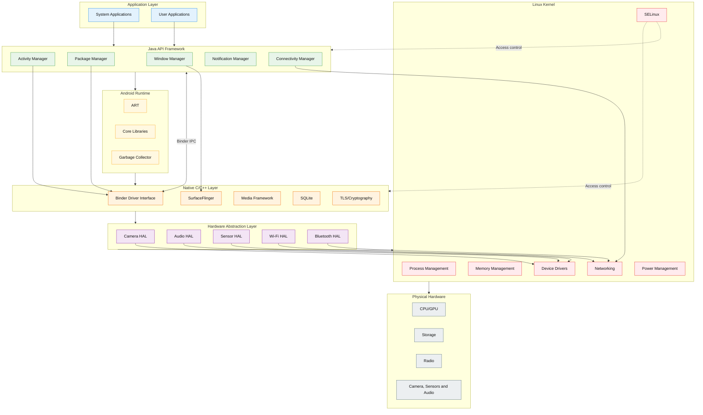

```mermaid
flowchart LR
    A(["Select<br/>system<br/>topic"])
    B["Study<br/>Android<br/>architecture"]
    C["Define<br/>component<br/>interfaces"]
    D{"Implementation<br/>level?"}

    E["Application<br/>Framework<br/>Kotlin or Java"]
    F["Native Layer<br/>C or C++ with<br/>NDK"]
    G["System Layer<br/>AIDL, HAL or<br/>native service"]

    H["Build with<br/>Gradle or CMake"]
    I["Deploy using<br/>ADB"]
    J["Execute test<br/>cases"]

    K{"Expected behavior?"}
    L["Collect logs<br/>and<br/>traces"]
    M["Analyze process, IPC,<br/>memory, CPU and I/O"]
    N["Fix<br/>implementation"]
    O["Security<br/>validation"]
    P["Performance<br/>evaluation"]
    Q["Document<br/>architecture<br/>and experimental results"]
    R(["Complete<br/>laboratory"])

    A --> B --> C --> D

    D -->|"High level"| E
    D -->|"Native<br/>library"| F
    D -->|"Platform<br/>integration"| G

    E --> H
    F --> H
    G --> H

    H --> I --> J --> K

    K -->|"No"| L
    L --> M
    M --> N
    N --> H

    K -->|"Yes"| O
    O --> P
    P --> Q
    Q --> R

    classDef terminal fill:#263238,color:#fff,stroke:#111,stroke-width:3px
    classDef activity fill:#e3f2fd,color:#111,stroke:#1e88e5
    classDef decision fill:#fff3e0,color:#111,stroke:#fb8c00,stroke-width:2px
    classDef implementation fill:#e8f5e9,color:#111,stroke:#43a047
    classDef evaluation fill:#f3e5f5,color:#111,stroke:#8e24aa

    class A,R terminal
    class B,C,H,I,J,L,M,N,Q activity
    class D,K decision
    class E,F,G implementation
    class O,P evaluation
```
    

        
    

# **`Awesome`** Android System Programming Resource 

 

    
    &nbsp;
    
    &nbsp;
    
    

## 📖 Contents
- [Books](#books)
- [Videos](#videos)
- [My Other Awesome Lists](#my-other-awesome-lists)
- [Contributing](#contributing)
- [Contributors](#contributors)

##

### Books
- [Androids: The Team that Built the Android Operating System](https://www.amazon.com/Androids-Built-Android-Operating-System-ebook/dp/B09QPMNWS5)
- [Android System Programming: Porting, customizing, and debugging Android HAL](https://www.amazon.com/Android-System-Programming-customizing-debugging-ebook/dp/B072M68RN9)
- [Inside the Android OS: Building, Customizing, Managing and Operating Android System Services (Android Deep Dive)](https://www.amazon.com/Inside-Android-OS-Customizing-Operating-ebook/dp/B08F5J141P)
- [Android Security Internals: An In-Depth Guide to Android's Security Architecture](https://www.amazon.com/Android-Security-Internals-Depth-Architecture/dp/1593275811)

### Videos

##

### My Other Awesome Lists
You can access the my other awesome lists [here](https://cyberthreatdefence.com/my_awesome_lists)

### Contributing
[Contributions of any kind welcome, just follow the guidelines](contributing.md)!

### Contributors
[Thanks goes to these contributors](https://github.com/cybersecurity-dev/awesome-android-system-programming-resource/graphs/contributors)!

### License

[🔼 Back to top](#awesome-android-system-programming-resource-)
